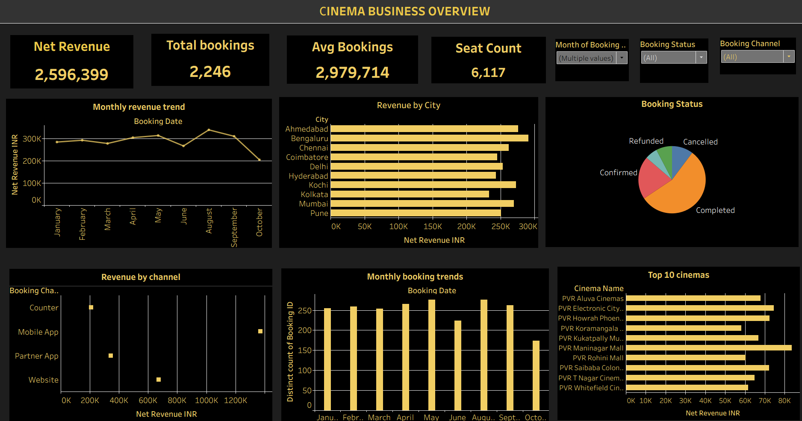

# 🎬 PVR Movie Booking Analytics

### Interactive Tableau Dashboard | Data Analytics Portfolio Project

## 🎬 Dashboard Video Demo


Watch the complete walkthrough of the PVR Movie Booking Analytics Tableau dashboard.

▶️ **[Click here to watch the dashboard video](https://youtu.be/veqIBBCprtA)**

 

## 🖼️ Dashboard Preview

### Cinema Business Overview



## 📌 Project Overview

PVR Movie Booking Analytics is an interactive data analytics portfolio project developed using Tableau to analyze movie bookings, revenue performance, cinema operations, booking channels, and customer booking trends.

The project uses a synthetic movie booking dataset to demonstrate how raw data can be transformed into meaningful business insights through interactive dashboards and data visualization.

The dashboard helps explore revenue trends, compare city and cinema performance, understand booking statuses, and identify patterns in booking activity.

> **Disclaimer:** This project uses synthetic/demo data for learning and portfolio purposes. It is not official PVR Cinemas data and does not represent actual company performance.

## 🎯 Business Objectives

- Analyze total bookings and net revenue.
- Track monthly revenue trends.
- Compare revenue performance across cities.
- Understand booking status distribution.
- Analyze revenue by booking channel.
- Identify top-performing cinemas by revenue.
- Monitor monthly booking activity.
- Build interactive dashboards for business reporting.

## 🛠️ Tools and Technologies

| Tool | Purpose |
|---|---|
| Tableau Desktop | Dashboard development and data visualization |
| Microsoft Excel | Dataset storage and inspection |
| GitHub | Project documentation and version control |

## 📂 Dataset Description

The project uses an Excel workbook named `PVR_Movie_Booking_Tableau_Dataset(1).xlsx`.

The workbook contains the following worksheets:

| Worksheet | Description |
|---|---|
| Bookings | Booking details, amounts, discounts, and booking status |
| Movies | Movie titles, genres, languages, and attributes |
| Customers | Customer and membership information |
| Cinemas | Cinema locations and facilities |
| Screens | Screen capacity and technical details |
| Showtimes | Movie schedules, ticket prices, and occupancy |
| Payments | Payment transactions and statuses |
| Tickets | Individual ticket and seat information |
| Read_Me | Dataset instructions |
| Data_Dictionary | Table and column definitions |

The dataset represents synthetic movie booking activity. Monetary values are expressed in Indian rupees (INR).

## 📊 Dashboard Overview

### 1. Cinema Business Overview

The main dashboard provides a consolidated view of cinema booking and revenue performance.

**Key Performance Indicators (KPIs):**
- Net Revenue
- Total Bookings
- Average Bookings
- Seat Count

**Visualizations:**
- Monthly Revenue Trend — tracks revenue changes over time.
- Revenue by City — compares revenue across cities.
- Booking Status — displays the distribution of booking statuses.
- Revenue by Channel — compares revenue across booking channels.
- Monthly Booking Trends — shows booking activity by month.
- Top 10 Cinemas — identifies cinemas with the highest revenue.

**Interactive Filters:**
- Month of Booking
- Booking Status
- Booking Channel

These filters allow users to explore the dashboard based on selected booking periods, statuses, and channels.

## 📈 Key Performance Indicators

| KPI | Description |
|---|---|
| Net Revenue | Revenue after applicable adjustments, according to the workbook calculation |
| Total Bookings | Number of distinct bookings |
| Average Bookings | Average booking metric displayed in the dashboard |
| Seat Count | Seat count metric displayed in the dashboard |

KPI definitions and calculations should be interpreted according to the calculated fields and aggregation settings used in the Tableau workbook.

## 🔍 Business Questions Explored

- How does net revenue change from month to month?
- Which cities generate higher revenue?
- What is the distribution of booking statuses?
- Which booking channels contribute the most revenue?
- How does booking activity vary over time?
- Which cinemas rank among the top 10 by revenue?
- How can interactive filters help users explore business performance?

## 💡 Key Business Insights

The dashboard supports the investigation of revenue performance, booking trends, city-level differences, booking channel contributions, and cinema-level performance.

Specific findings should be documented after verifying the underlying chart values and calculations. This avoids reporting unsupported conclusions from the visualizations alone.

## 📁 Repository Structure

```text
PVR-Movie-Booking-Analytics/
│
├── README.md
│
├── data/
│   └── PVR_Movie_Booking_Tableau_Dataset(1).xlsx
│
├── workbook/
│   └── pvr.twb
│
├── videos/
│   └── pvr.mp4
│
└── screenshots/
    └── overview.png
```

## 🚀 How to Explore the Project

1. Clone or download this repository.
2. Open `workbook/pvr.twb` in Tableau Desktop.
3. Reconnect the Excel dataset if Tableau requests it.
4. Open the Cinema Business Overview dashboard.
5. Explore the KPI cards, visualizations, and interactive filters.
6. Watch the dashboard walkthrough using the video link above.

## 💼 Skills Demonstrated

- Data visualization and dashboard development
- KPI design and business reporting
- Exploratory data analysis
- Revenue and booking analysis
- Interactive dashboard design
- Data relationships and aggregation
- Data storytelling
- Business insight communication

## 👨‍💻 About the Project

This project is part of my Data Analytics portfolio and demonstrates my ability to organize datasets, build interactive Tableau dashboards, analyze business metrics, and communicate information through visualizations.

The project reflects my interest in using data analytics to understand business performance and support data-driven decision-making.

---

*Created as a data analytics practice project using synthetic/demo data.*
